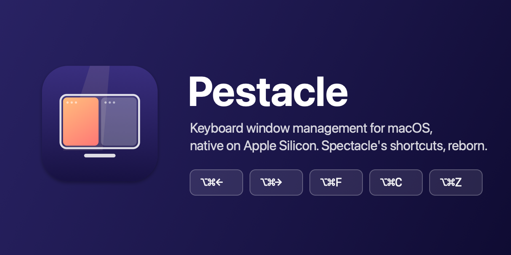

<p align="center">
  
</p>

<p align="center">
  <a href="https://github.com/maximebriand/pestacle/releases/latest"></a>
  
  
  
  <a href="LICENSE"></a>
</p>

<p align="center">
  <a href="https://github.com/maximebriand/pestacle/releases/latest/download/Pestacle.zip"><b>⬇︎ Download the latest version</b></a> · macOS 14+ · Apple Silicon
</p>

<p align="center"><a href="README.fr.md">Lire en français</a></p>

---

[Spectacle](https://github.com/eczarny/spectacle) taught a generation of Mac users to throw windows around with ⌥⌘ and the arrow keys. It was archived in 2019 and only ships as an Intel binary. **Pestacle** brings it back as a small, native Apple Silicon app with the same shortcuts and no setup: install it, grant Accessibility access, and your fingers already know what to do.

*« Pestacle » is how French kids say « spectacle » — it's a tricky word.*

## Features

- **Halves, quarters, thirds, fullscreen, center**, make larger / smaller, next / previous display.
- **Size cycling**: press ⌥⌘← again and the window goes ½ → ⅔ → ⅓, just like Spectacle.
- **Undo / redo** window moves, per window.
- **Spectacle's default shortcuts**, adapted to your keyboard layout: on AZERTY, ⌥⌘Z really is the key labelled Z.
- **Imports your Spectacle shortcuts** on first launch, and offers to quit Spectacle so both apps don't fight over the same keys.
- **Plays well with stubborn apps**: honours minimum sizes and resize increments (Terminal, Chrome, Safari), and keeps working with Electron apps.
- **Customisable shortcuts**, checked against Pestacle's own and against macOS system shortcuts.
- Menu bar app, no Dock icon, launch at login, English and French.
- Tiny and dependency-free: Swift 6, AppKit and SwiftUI, nothing else.

## Shortcuts

| Action | Shortcut | | Action | Shortcut |
|---|---|---|---|---|
| Left / right half | ⌥⌘← / ⌥⌘→ | | Fullscreen | ⌥⌘F |
| Top / bottom half | ⌥⌘↑ / ⌥⌘↓ | | Center | ⌥⌘C |
| Upper left / right quarter | ⌃⌘← / ⌃⌘→ | | Next / previous third | ⌃⌥→ / ⌃⌥← |
| Lower left / right quarter | ⌃⇧⌘← / ⌃⇧⌘→ | | Make larger / smaller | ⌃⌥⇧⌘→ / ⌃⌥⇧⌘← |
| Next / previous display | ⌃⌥⌘→ / ⌃⌥⌘← | | Undo / redo last move | ⌥⌘Z / ⌥⇧⌘Z |

Every shortcut can be changed or cleared in Settings.

## Install

1. **[Download Pestacle.zip](https://github.com/maximebriand/pestacle/releases/latest/download/Pestacle.zip)** (always the latest version; all versions are on the [releases page](https://github.com/maximebriand/pestacle/releases)). It is signed with a Developer ID and notarized by Apple.
2. Unzip it and move **Pestacle** to your Applications folder, then open it.
3. Pestacle asks for **Accessibility** access, which it needs to move other apps' windows. Click *Open System Settings* and turn Pestacle on. It picks up the permission within seconds, no restart needed.

Requires macOS 14 Sonoma or later on an Apple Silicon Mac.

### Coming from Spectacle

On first launch Pestacle imports the shortcuts you customised in Spectacle (it only reads `~/Library/Application Support/Spectacle/Shortcuts.json`). If Spectacle is running, Pestacle offers to quit it: only one app can own a given shortcut. Remember to remove Spectacle from your login items.

## Differences from Spectacle

Pestacle aims for muscle-memory compatibility, with a few deliberate changes:

| | Spectacle | Pestacle |
|---|---|---|
| Letter shortcuts on non-QWERTY layouts | physical QWERTY position (⌥⌘Z is ⌥⌘W on AZERTY) | the key with that letter on your layout |
| Make larger / smaller | 30 pt steps | 5 % of the screen, keeps edges that touch the screen |
| Center a window bigger than the screen | keeps the size | shrinks it to fit |
| Display order | main display first | left to right, as arranged in System Settings |
| Undo history | per app, 50 moves | per window, 20 moves |
| Shortcut taken by another app | cleared | kept, marked inactive, retried when that app quits |
| Size cycling | always on | can be turned off |

Pestacle is keyboard-only by design: to tile windows by dragging them to screen edges, use the tiling built into macOS 15 and later, which Pestacle doesn't interfere with. Not in this first version: disabling shortcuts per app or for an hour.

## Build from source

You need Xcode 16 or later and [XcodeGen](https://github.com/yonaskolb/XcodeGen) (`brew install xcodegen`).

```sh
make build                     # generate Pestacle.xcodeproj, build Debug
make test                      # run the test suite and print a summary
make run                       # build and (re)launch the app
make build IDENTITY=- TEAM=    # without the project's Developer ID certificate (ad-hoc signing)
```

With ad-hoc signing, macOS asks for Accessibility access again after each rebuild. The Xcode project is generated from `project.yml` and not checked in.

### How it's built

Pestacle was developed **spec-first** with [OpenSpec](https://github.com/Fission-AI/OpenSpec): the behaviour lives as testable requirements in [`openspec/`](openspec), and the code follows. A few pointers:

- [`Sources/PestacleCore`](Sources/PestacleCore) — pure geometry (layouts, size cycling, thirds, displays, history, shortcut validation), no AppKit, covered by unit tests.
- [`Sources/Pestacle/System`](Sources/Pestacle/System) — Accessibility API, Carbon hot keys, keyboard layouts, login items.
- [`docs/recette.md`](docs/recette.md) — the acceptance run against real apps (Safari, Chrome, VS Code, Terminal, Notes, Calculator).

Contributions are welcome: please open an issue first for anything that changes behaviour, so the spec can move with it.

## Credits

Pestacle is an independent project inspired by [Spectacle](https://github.com/eczarny/spectacle) by Eric Czarny, and is not affiliated with it. Thanks to [Rectangle](https://github.com/rxhanson/Rectangle) for documenting many Accessibility API quirks.

## License

[MIT](LICENSE) © 2026 Maxime Briand
